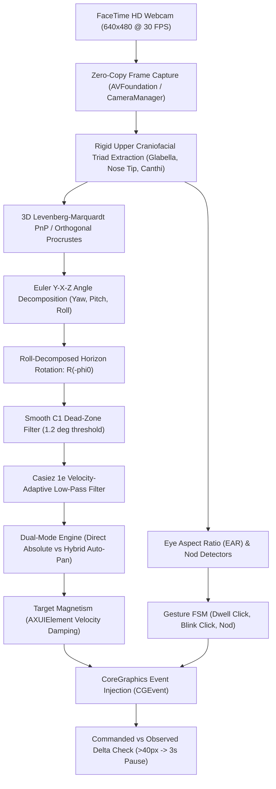

# System Architecture & Technical Specifications

## 1. High-Level System Architecture

HeadMotion Mouse is architectured across two coordinated implementations sharing a unified mathematical specification:
1. **Python Reference Prototype (`python-prototype/`):** Fast scientific validation using MediaPipe Tasks, OpenCV, and CoreGraphics ctypes bindings.
2. **Native macOS Application (`macos-app/`):** Commercial-grade Swift 6 / SwiftUI application with zero-copy `CVPixelBuffer` streaming, `Vision.framework`, hardware-accelerated math, and click-through spatial HUD overlay.

## 2. Speech & Headphone Immunity: The Upper Craniofacial Triad
Standard facial pose estimators include the chin (menton) and mouth corners (cheilion). When speaking, eating, or laughing, chin deflection introduces massive pitch artifacts (cursor dips downward). Furthermore, over-ear headphones (such as JBL Live 770NC, Sony WH-1000XM5, Bose QuietComfort, AirPods Max, etc.) occlude ear and temple contours.

HeadMotion Mouse solves this by anchoring strictly to the **Rigid Upper Craniofacial Triad**:
- **Pronasale (Nose Tip)**
- **Nasion / Glabella (Between Eyebrows)**
- **Endocanthion Left & Right (Inner Eye Corners)**
- **Exocanthion Left & Right (Outer Eye Corners)**
- **Supraorbital Left & Right (Mid-Eyebrows)**

Because these landmarks sit on the skull's rigid frontal bone, pose estimation is mathematically invariant to speech articulation and immune to headphone earcups.

## 3. Translation Invariance vs Parallax Compensation
- In pure rotation mode, `solvePnP` recovers 3D orientation $\mathbf{R}$ independently of spatial translation $\mathbf{t}$. Leaning in a chair modifies $\mathbf{t}$, not $\mathbf{R}$, guaranteeing zero cursor drift without needing parallax subtraction.
- In hybrid projection modes where nose-tip screen coordinate displacement is blended with angular rotation, camera perspective induces artificial shift. The calibrated parallax compensator applies:
  $$\psi_{\text{corr}} = \psi - k_{\text{parallax}} \cdot \operatorname{arctan2}(T_x, T_z)$$
  $$\theta_{\text{corr}} = \theta - k_{\text{parallax}} \cdot \operatorname{arctan2}(T_y, T_z)$$

## 4. Signal Processing Chain
1. **Roll-Decomposed Horizon Alignment:** Projects deltas into the user's natural horizon frame by rotating $(\Delta \psi, \Delta \theta)$ by $-\phi_0$.
2. **Smooth Dead-Zone Function:** Eliminates micro-tremors at rest using quadratic asymptotic curvature ($C^0$ and $C^1$ continuous).
3. **Casiez 1€ Filter:** Velocity-adaptive low-pass filtering dynamically shifts cutoff between $f_{c_{\min}} = 1.0\text{ Hz}$ (stationary stability) and higher frequencies during rapid head turns (low phase lag).
4. **Target Magnetism (Accessibility UI Gravity):** Queries `AXUIElementCopyElementAtPosition` at ~15 Hz when cursor velocity drops under 150 px/s, damping sensitivity to $0.45\times$ over clickable controls.

## 5. Safety Invariants & Physical Mouse Override
- **Face-Loss Freeze:** Instant cursor lock and timer abortion when tracking confidence drops below $0.65$.
- **Re-Entry Blending:** 10 stable consecutive frames required upon return, linearly blended over 300 ms to eliminate spatial teleportation jumps.
- **Physical Override Detection:** Observed cursor coordinate is compared against commanded coordinate; if unexplained discrepancy exceeds $40\text{ px}$, head tracking automatically yields for 3 seconds.
